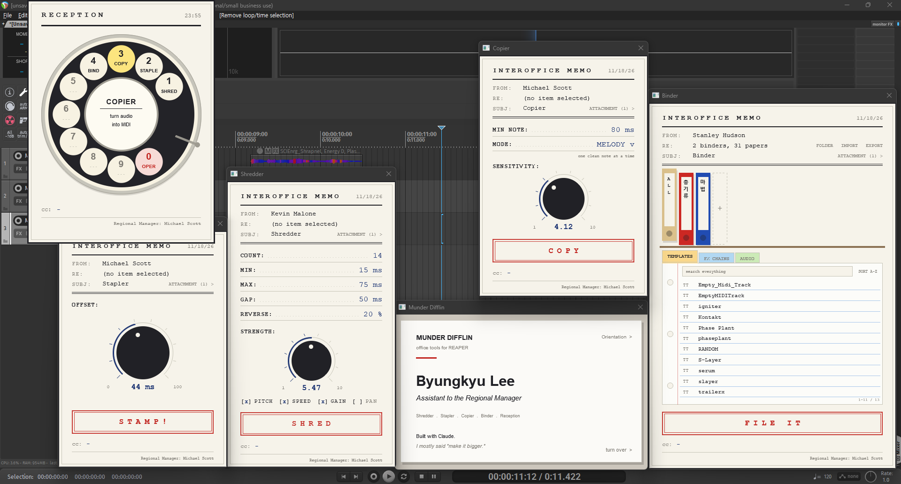

# Munder Difflin

Small, office-themed tools for sound design in [REAPER](https://www.reaper.fm).
Interoffice memos, rubber stamps, binders on a shelf and a rotary phone at the front desk.



| Tool | What it does |
|---|---|
| **Reception** | The front desk. Dial 1-4 to open a tool, 5-9 for your own custom dials, 0 for the operator. |
| **Shredder** | Feed it audio, get random scraps back: random slices with pitch, speed, gain and pan automation. Good for happy accidents. |
| **Stapler** | Lines up the first transient of every selected layer, with an optional offset. |
| **Copier** | Copies audio into MIDI. Five modes: ALL, CHORDS, MELODY, BASS, HITS. |
| **Binder** | Files track templates, FX chains and audio into binders, tabs and sections. Drag them straight onto tracks. |
| **Munder Difflin** | Credits, orientation, and settings shared by every tool. |

## Workflow

A typical session, start to finish:

1. **Open the launcher.** Run **Reception** (best bound to a key). Click a hole or press 1-4 to open a tool.
   Holes 5-9 can hold any REAPER action you use often (right-click a hole to assign one).
2. **Make raw material with Shredder.** Select one or more audio items, set how many fragments you want,
   their min/max length and the strength of the variation, then press **SHRED**. Fragments land on a new
   track below the source, each with its own pitch, speed, gain and pan movement. Shift+SHRED re-rolls.
3. **Stack layers with Stapler.** Select the items you want to layer (one per track works best) and press
   **STAMP!**. Their first transients line up with the top layer; the Offset knob staggers each next layer
   by a few milliseconds for a looser, thicker hit.
4. **Pull MIDI out of audio with Copier.** Select audio, pick a mode and press **COPY**. A MIDI item appears
   on a new track below:
   - **ALL**: every peak, overtones included (texture, experiments)
   - **CHORDS**: fundamentals only, several at once (pads, guitar, piano)
   - **MELODY**: one note at a time (voice, whistle, lead)
   - **BASS**: the lowest note only
   - **HITS**: note 36 on every transient, ready to trigger drum samples
5. **Keep what works with Binder.** Select items or tracks and press **FILE IT**:
   items are saved as WAV copies, tracks as track templates or FX chains (you pick which plugins).
   Organize everything into binders, tabs and sections, search, sort and preview audio.
   Drag a paper onto a track to use it again (or double-click it to use it on the selected track).
   You can also drop audio files from anywhere (file browser, samplers) onto the Binder window.
6. **Adjust settings on the card.** Open **Munder Difflin** (or dial 0 in Reception) and turn the card over
   to change the size of every tool, switch lettering, clear custom dials or reset window positions.

### Shortcuts

| Where | Key / action | Does |
|---|---|---|
| All tools | Drag a value up/down (Shift = fine), mouse wheel, double-click to type | Change a value |
| All tools | Enter | Run the tool's main button |
| All tools | Esc | Close |
| Shredder | Shift+Enter or Shift+click SHRED | Re-roll the last result |
| Binder | Ctrl+Z / Ctrl+F / Ctrl+A / Del | Undo / search / select all / shred selection |
| Binder | Shift-click, Ctrl-click | Select a range, add to selection |
| Binder | Space, click the waveform | Preview audio (SWS: in place) |
| Reception | 1-9, 0 | Dial |

## Install (ReaPack)

1. In REAPER: **Extensions > ReaPack > Import repositories...**
2. Paste:
   ```
   https://github.com/koreanantman/munderdifflin-reaper/raw/main/index.xml
   ```
3. **Extensions > ReaPack > Browse packages**, search **Munder Difflin**, install.

All tools install together into one folder (Reception opens the others from there).

### Tip
Bind **Reception** to a key. When REAPER asks what to do with the already running
instance, choose **Terminate instances** and **Remember my answer**. The same key then
opens and closes the front desk.

## Requirements
- REAPER 6 or newer
- Optional: [SWS](https://www.sws-extension.org) (in-place audio preview in Binder, clipboard for custom dials)
- Optional: [js_ReaScriptAPI](https://forum.cockos.com/showthread.php?t=212174) (borderless Reception, folder picker)

## Credits
Byungkyu Lee, Assistant to the Regional Manager.

Built with Claude. I mostly said "make it bigger."

*A fan-made parody. Not affiliated with or endorsed by NBC, Universal or The Office.*

## License
[MIT](LICENSE)
